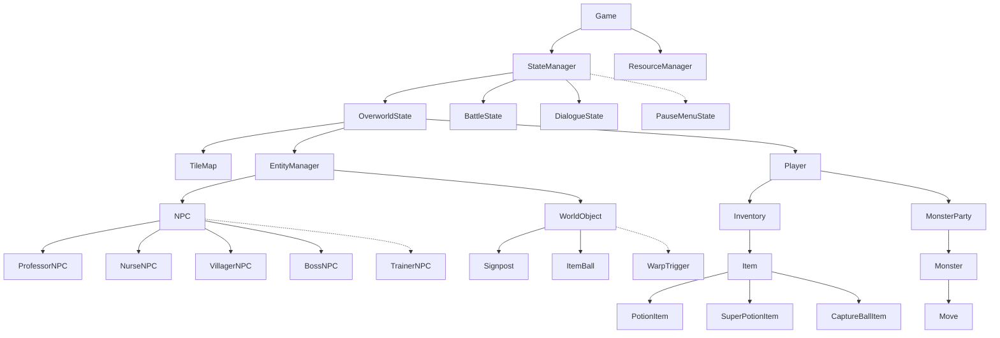

# Monster RPG - Project Status, Roadmap & Future Enhancements

---

## 🏆 Current Milestone (v1.0 - OOP Core Architecture) - COMPLETED

### 1. Movement & Controls
- [x] **Tap-to-Turn System:** Turning on the current tile without advancing on single key taps.
- [x] **Smooth Grid Movement:** Deterministic 16px tile-to-tile movement with linear delta-time interpolation.
- [x] **Sprint / Running Shoes:** Holding `[Shift]` activates rapid movement (120 px/sec vs 55 px/sec) and dynamically switches to the running spritesheet (`assets/HGSS_boy_run.png`).
- [x] **Solid Entity Collision:** Prevents player from phasing through NPCs, the Boss, signposts, or environment obstacles.

### 2. Dual Biome World (Oakdale Town & Whispering Woods)
- [x] **Procedural TileMap (44x28 Grid):**
  - **Oakdale Town (West):** Cobblestone streets, street lamps, flower beds, perimeter fences, Professor's Lab (Blue Roof), Health Clinic (Red Roof), and Town Sign.
  - **Whispering Woods (East):** Dense forest borders, winding dirt trails, tree canopies, patches of dark tall grass, hidden item ball, and Guardian Boss clearing.
- [x] **32x32 Tileset Atlas:** Custom assembled atlas (`assets/world_tileset.png`) seamlessly scaled to 16x16 world units.

### 3. Object-Oriented Entity System
- [x] **`Entity` Abstract Base Class:** Unified hierarchy for actors and props.
- [x] **`Character` Intermediate Class:** Encapsulates facing directions, animations, and movement states.
- [x] **`Player`:** Manages inventory, party, sprint state, and interaction raycasts.
- [x] **`NPC` Polymorphism:**
  - `ProfessorNPC`: Starter distribution (`Pyropup`), quest prompt, dialogue branching.
  - `NurseNPC`: Fully restores party HP.
  - `VillagerNPC`: Type chart and gameplay tips.
  - `BossNPC`: High-level encounter trigger for the Forest Guardian `Sylvanguard`.
- [x] **`WorldObject` Hierarchy:** `Signpost` reading and `ItemBall` collectables.

### 4. Turn-Based RPG Battle Engine
- [x] **Tall Grass Random Encounters:** 18% step chance in tall grass patches.
- [x] **Turn-Based Combat:** Options for `FIGHT`, `BAG`, `CATCH`, and `RUN`.
- [x] **Elemental Affinity Matrix:** Type effectiveness multipliers (Fire, Water, Grass, Electric, Normal).
- [x] **Combat Animations:**
  - Attacker lunges & snaps back.
  - Defending monster shakes side-to-side and hit-flashes red.
  - Elemental particle FX (Fire swirls, Water bubbles, Razor leaves, Lightning bolts, Slashing strikes).
  - Floating rising damage numbers (`-18 HP`).
  - Parabolic Pokéball throw arc with 3-stage platform wobble and starburst capture effects.
- [x] **Progression & Safety:** EXP scaling and level-ups; faint blackout safely respawns player at Nurse Joy's Clinic.

---

## 🚀 Future Roadmap & Next Enhancements

---

### Phase 1: Audio & Sound Effects Engine (SFML Audio Integration)
*SFML::Audio is already linked in `CMakeLists.txt`; this phase will bring the retro world to life with dynamic BGM and sound effects.*

- [ ] **1.1. AudioManager Singleton / System Class:**
  - Centralized manager holding background music (`sf::Music`) and sound buffers (`sf::SoundBuffer`, `sf::Sound`).
  - Independent volume controls for BGM and SFX.
- [ ] **1.2. Background Music (BGM):**
  - **Town Theme:** Peaceful, acoustic retro melody for Oakdale Town.
  - **Forest Theme:** Mysterious, ambient woodland theme for Whispering Woods.
  - **Battle Theme:** Energetic, fast-paced battle theme for wild encounters.
  - **Boss Theme:** Intense, climactic battle theme when confronting Sylvanguard.
- [ ] **1.3. Sound Effects (SFX):**
  - **Overworld SFX:** Grass rustle footsteps, bump sound when walking into a solid obstacle, door opening sound, item pickup chime.
  - **Combat SFX:**
    - Attack sounds: Fire whoosh, water splash, vine lash, electric shock, normal strike thud.
    - Hit feedback: Super-effective crunch sound, damage hit sound.
    - Ball SFX: Ball throw whoosh, platform bounce, click sound upon successful catch.
    - Victory jingle & Level-Up celebration fanfare.

---

### Phase 2: Save / Load System & Data Persistence (OOP Serialization)
*Allow players to save their journey and resume anytime.*

- [ ] **2.1. Serializable Save Profile (`SaveData` Class):**
  - Encapsulate player coordinates `(gridX, gridY)`, facing direction.
  - Save full Monster Party: Species, Level, Current HP, Max HP, Moves, Current EXP.
  - Save Inventory: Item IDs and quantities.
  - Save World State Flags: Starter chosen flag, boss defeated flag, collected item balls list.
- [ ] **2.2. JSON / Binary File Format:**
  - Save file stored in `saves/savegame.dat`.
  - Automatic error validation (detecting corrupt or missing save files).
- [ ] **2.3. In-Game Pause Menu (`PauseMenuState`):**
  - Open with `[Esc]` or `[Tab]` during overworld exploration.
  - Options:
    1. **POKÉMON:** Inspect party summary, stats, moves, and health.
    2. **BAG:** View inventory items, count, and descriptions.
    3. **SAVE:** Save game progress with confirmation dialog.
    4. **OPTIONS:** Toggle sound volume and screen scaling.
    5. **EXIT:** Return to main title screen or desktop.

---

### Phase 3: Building Interiors & Warp System (Multilevel Maps)
*Seamless transitions into indoor buildings.*

- [ ] **3.1. `WarpTrigger` Entity:**
  - New entity type placed on doors and cave entrances:
    - Stores `targetMapId`, `targetSpawnTile`, and `entryDirection`.
- [ ] **3.2. Indoor Map Scenes:**
  - **Oak's Research Lab Interior:** Bookshelves, PC terminals, Pokéball display table, research assistants.
  - **Pokémon Center Interior:** Healing counter, Nurse Joy desk, healing machine with flashing Pokéball slots, PC storage terminal.
- [ ] **3.3. Smooth Camera Fade Transitions:**
  - Screen fade-to-black (0.25s) $\rightarrow$ swap map $\rightarrow$ fade-in (0.25s).

---

### Phase 4: Battle & Combat Mechanics Expansion
*Deepen the RPG tactical depth.*

- [ ] **4.1. In-Combat Party Swapping:**
  - Add `[5] POKÉMON` option to battle menu.
  - Opens party list; player can choose to withdraw active monster and send out another teammate.
  - Costs the player's turn (opponent monster gets a chance to attack upon entry).
- [ ] **4.2. Status Conditions Engine:**
  - Add status conditions to `Monster`:
    - **Burn:** Deals 1/16 HP damage per turn; lowers physical attack power.
    - **Poison:** Deals 1/8 HP damage per turn.
    - **Paralysis:** 25% chance of skipping turn; reduces speed by 50%.
    - **Sleep:** Monster unable to act for 1-3 turns.
  - Add status ailment icons next to HP bars in the battle HUD.
- [ ] **4.3. Status & Buff/Debuff Moves:**
  - Moves like `Growl` (lowers opponent Attack), `Leer` (lowers Defense), `Agility` (boosts Speed), `Recover` (restores 50% HP).
- [ ] **4.4. Critical Hits & Move Accuracy RNG:**
  - 1/16 base chance for critical hits (1.5x damage with special visual message).
  - Accuracy check formula (`accuracy%` vs random roll) allowing moves to miss under pressure.

---

### Phase 5: NPC Artificial Intelligence & Trainer Battles
*Make townspeople and rival trainers feel alive.*

- [ ] **5.1. Autonomous NPC Wandering State Machine:**
  - NPCs cycle between `Idle` and `Wandering` states.
  - Pick random cardinal direction, check tile collision, take a step, and wait for 2-5 seconds.
  - Freeze and face the player immediately upon interaction.
- [ ] **5.2. Trainer Battle Class (`TrainerNPC`):**
  - Inherits from `NPC`.
  - Holds an opponent monster party and pre-battle dialogue.
  - **Line-of-Sight Trigger:** If the player walks within 3-4 tiles in front of a trainer:
    - An exclamation mark `(!)` pops over the trainer's head.
    - Trainer walks up to the player, delivers battle banter, and initiates a Trainer Battle!
- [ ] **5.3. Quest Engine (`Quest` & `QuestManager`):**
  - Polymorphic quest stages: `NotStarted`, `Active`, `Completed`.
  - Example Quest 1: *"The Professor's Lost Notebook"* - Find the notebook hidden in a secluded grove in Whispering Woods.
  - Example Quest 2: *"Forest Guardian pacification"* - Challenge Sylvanguard and return to Oak for a Champion Medal.

---

### Phase 6: Visual Aesthetics & World Polish
*Enhance atmosphere and sensory engagement.*

- [ ] **6.1. Ambient Day / Night Cycle:**
  - Dynamic ambient color overlay (`sf::Color(r, g, b, alpha)`) tied to real time or in-game timer.
  - Golden sunrise $\rightarrow$ bright daytime $\rightarrow$ orange/purple sunset $\rightarrow$ deep dark navy night.
  - Town street lamps automatically glow yellow during nighttime.
- [ ] **6.2. Atmospheric Weather & Particle Systems:**
  - Occasional rainfall with diagonal rain streak particles and ripple splashes.
  - Drifting wind-blown autumn leaves in the forest.
- [ ] **6.3. Bestiary / Pokédex Interface:**
  - View all discovered species, their element types, base stats, lore descriptions, and where they can be found.

---

## 🛠️ Architecture Design Summary

---

## 🎮 Current Controls Quick Reference
| Key | Context | Action |
| :--- | :--- | :--- |
| **`W, A, S, D`** | Overworld | Tap to turn in place; hold to walk |
| **`[Shift]` (Hold)** | Overworld | Sprint / Running Shoes (>2x movement speed) |
| **`[E]` / `[Space]`** | Overworld | Talk to NPCs, read signs, open item balls |
| **`[Space]` / `[E]`** | Dialogue | Advance dialogue / complete text typing |
| **`[1]`** | Battle | Open **FIGHT** (Move selection) |
| **`[2]`** | Battle | Open **BAG** (Use Potion / Super Potion) |
| **`[3]`** | Battle | Throw **CATCH** (Capture Ball) |
| **`[4]`** | Battle | **RUN** (Flee wild battles) |
| **`[1..4]`** | Battle (Moves) | Execute move 1 to 4 |
| **`[Esc]` / `[B]`** | Battle (Moves) | Cancel move selection and return to menu |